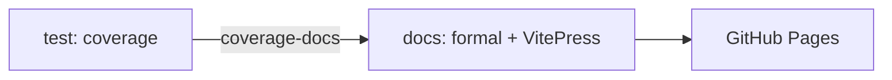

# About

A tiny FoBiS library, the project `.github/workflows/selftest.yml` runs every reusable workflow of
[fortran-toolchains](https://github.com/szaghi/fortran-toolchains) on. This site is built and deployed by the reusable
`docs` workflow: the API pages are written by `formal` (`npm run docs:build` runs it first), the coverage badge below by
the `test` workflow's coverage run.

The sum, computed by `src/examples/fixture_example_sum.f90`:

<<< ../examples/sum.txt
